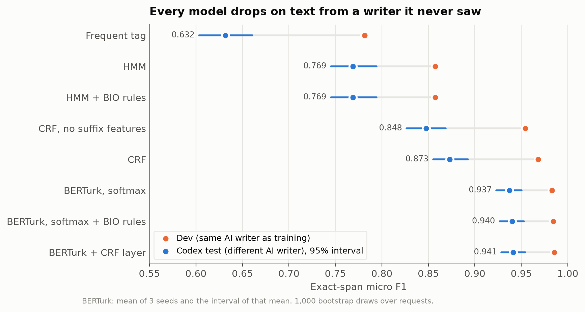
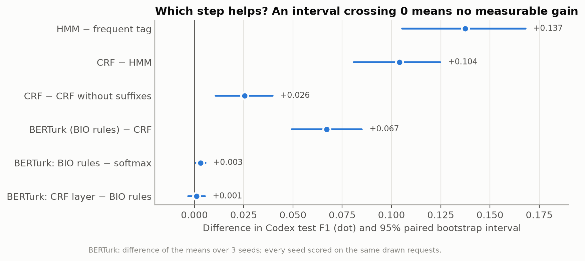
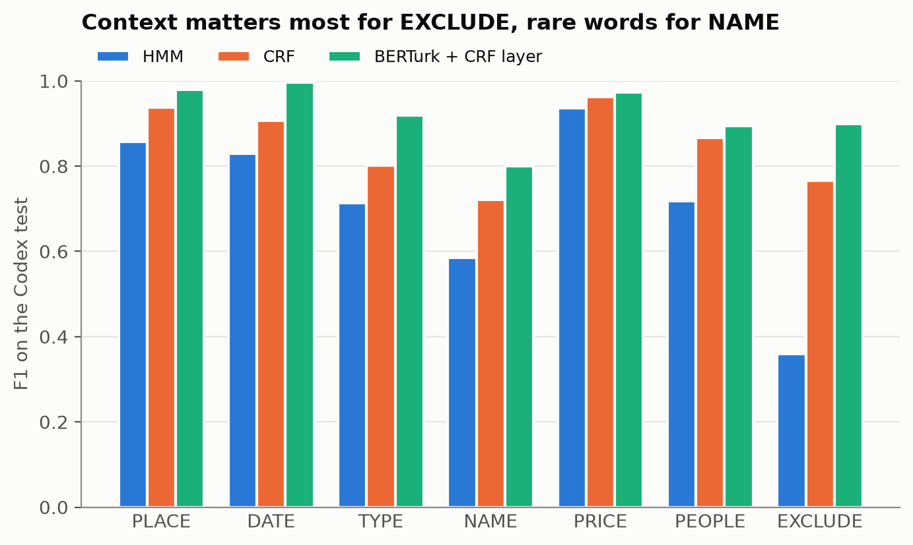
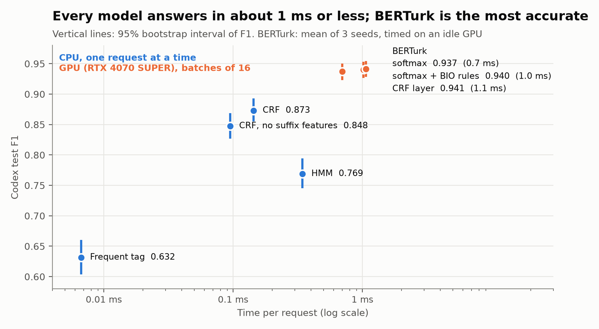
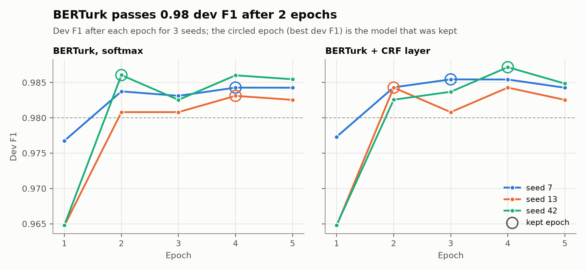
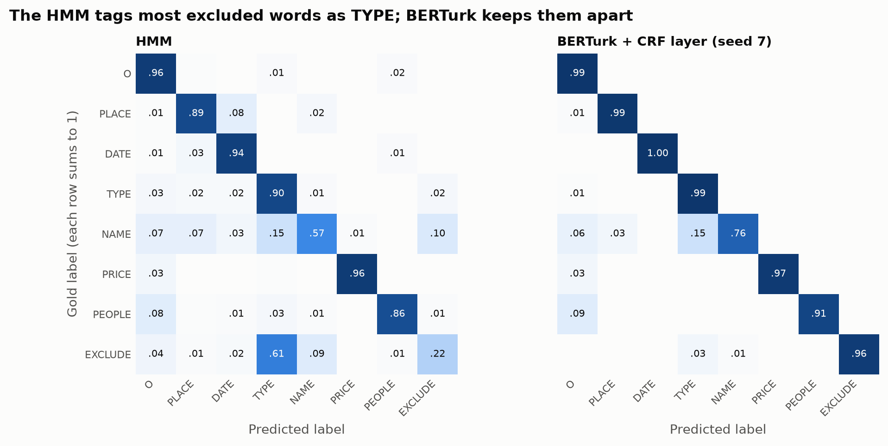
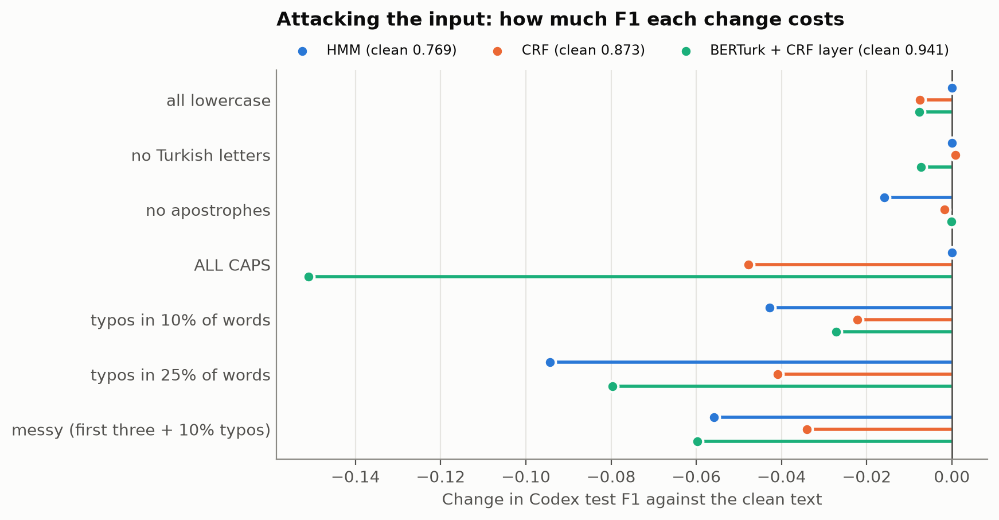
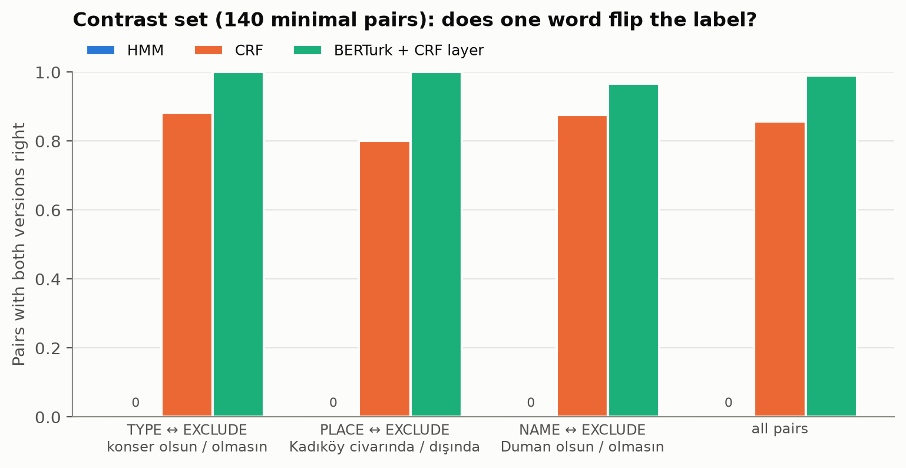
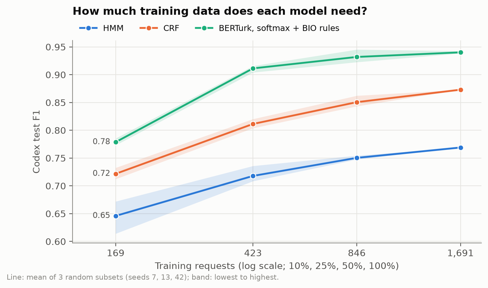

# Tagging Turkish event requests

COE025 Natural Language Processing, Project 2: Token Classification.
Solo project by İsmet Efe Balık (see `contributions/`). Project 1 (English slot filling) is kept unchanged in
`project1/`.

A user types a request to an event app, for example

```
bu akşam kadıköyde en fazla 500 TL stand-up, konser olmasın
```

The task is to give every word a BIO tag so the app can read off what the user wants:

| word | bu | akşam | kadıköyde | en | fazla | 500 | TL | stand-up | , | konser | olmasın |
|---|---|---|---|---|---|---|---|---|---|---|---|
| tag | B-DATE | I-DATE | B-PLACE | B-PRICE | I-PRICE | I-PRICE | I-PRICE | B-TYPE | O | B-EXCLUDE | O |

Seven labels (15 BIO tags): **PLACE, DATE, TYPE** (kind of event), **NAME** (performer, team, play), **PRICE**
(a price limit), **PEOPLE** (how many / who comes along) and **EXCLUDE** (what the user does *not* want).

Why this is harder than the slot filling of the lecture (`fly from Boston to Paris`):

- **Turkish suffixes are inside the word.** `kadıköyde` = Kadıköy + *-de* ("in"). The place is not a separate token,
  so the tagger must recognize a place from a word it may never have seen with that ending (`harbiyede`,
  `odunpazarı'nda`).
- **People type without Turkish letters** (`kadikoyde`, `aksam`, `ucretsiz`), in lowercase, with typos.
- **The same word changes label with context**, like *Washington* on the slides: `konser` is TYPE in
  `konser olsun` and EXCLUDE in `konser olmasın`. Only the next word decides.
- **Labels are about the request, not about the world**: `Kadıköy` is PLACE in `Kadıköy'de tiyatro` and EXCLUDE in
  `Kadıköy dışında tiyatro`.

There is no public Turkish dataset for this task, so this project built one. It is the request parser that
Bi' Plan (my event-recommendation app for İstanbul) needs.

## Data

All labels follow one written guide, [`data/GUIDELINES.md`](data/GUIDELINES.md) (span boundaries, suffixes,
NAME vs TYPE, what EXCLUDE covers).

| Set | How it was made | Requests | Use |
|---|---|---|---|
| AI-written | 10 Claude Haiku agents, 200 requests each, one focus per agent (cities, prices, exclusions, performers, very messy chat style, ...). Prompt: [`data/train_ai/PROMPT.md`](data/train_ai/PROMPT.md) | 2,000 → 1,691 train + 296 dev | train, choose settings |
| Codex test | Written by a **different AI** (OpenAI Codex) from the same guide, without seeing any training file. Prompt and history: [`data/test_codex/PROMPT.md`](data/test_codex/PROMPT.md) | 299 | test |
| Bi' Plan test | The 25 Turkish requests of the Bi' Plan golden set, written by me for the app, labeled following the guide | 25 | test |

Cleaning (`prepare_data.py`): every span must be found in its text on whole words, in order; lines that fail are
dropped and listed in `data/clean/stats.json` (0 in the final data). Duplicates are removed after lowercasing and
folding Turkish letters (`Kadıköy'de` = `kadikoyde`), and any training or dev request that matches a test request is
dropped. Dev is a fixed 15% of each AI part.

Honest notes on the data:
- The training data is AI-written, not collected from users. The Codex test exists so that a model cannot score well
  only by learning Haiku's writing style: every model scores 0.04–0.15 F1 lower on the Codex test than on dev (same
  writer as train), which shows the effect is real.
- The first Codex attempt was rejected and deleted unused: it came from one sentence template and had lost every
  Turkish letter. The second attempt was written in three batches (see the prompt file).
- All 299 Codex lines were reviewed against the guide. 23 labels were corrected; the original files are unchanged and
  the corrections, each with a reason, are in [`data/test_codex/fixes.json`](data/test_codex/fixes.json).
- The Bi' Plan set is small (25 requests) and its intervals are wide; it is a real-use check, not the main test.

Span counts (from `data/clean/stats.json`):

| Split | PLACE | DATE | TYPE | NAME | PRICE | PEOPLE | EXCLUDE |
|---|---|---|---|---|---|---|---|
| train | 1,214 | 924 | 1,131 | 271 | 568 | 518 | 390 |
| Codex test | 293 | 274 | 240 | 69 | 95 | 140 | 84 |

## Methods

Every method gives one tag per word; all are scored the same way.

| Method | File | What it is |
|---|---|---|
| Frequent tag | `hmm.py` | Each word gets the tag it had most often in training; unseen words get O (the slides' baseline). |
| HMM | `hmm.py` | Bigram hidden Markov model written from scratch: start, transition and emission probabilities by counting with add-0.1 smoothing, Viterbi decoding in log space. Unseen and rare words are mapped to an unknown-word class by their last two letters (`<UNK-de>`), so Turkish case endings still give a clue. `hmm_bio` also forbids IOB2-breaking transitions. |
| CRF | `crf.py` | Linear-chain CRF (sklearn-crfsuite) with word features: folded word, stem before the apostrophe, the suffix after it, last 1–4 letters, shape, neighbouring words. c1, c2 chosen on dev from a 3×3 grid (chosen: 0.05, 0.1). `crf_no_suffix` drops the suffix features. |
| BERTurk | `train_bert.py` | `dbmdz/bert-base-turkish-cased` fine-tuned as a token classifier, first sub-token of each word labeled (others −100). Decoded three ways: **softmax** (argmax per word), **softmax + BIO rules** (Viterbi over the same scores with IOB2-breaking transitions forbidden, no retraining), and **+ CRF layer** (learned transition scores, trained with the CRF loss log Z − gold score, Viterbi decoding). |

The HMM's Viterbi and the CRF layer's loss and decoding are checked against the worked examples of the week 6
slides in `tests/test_tagging.py` ("can fish" → VN with joint weight 0.1344; Z = 16 and loss = ln 2).

Training setup for BERTurk: AdamW (encoder 3e-5, head 1e-3), linear warmup 10%, batch 16, 5 epochs, bf16; the epoch
with the best dev F1 is kept. Three seeds (7, 13, 42) for every BERTurk variant.

## Results

Metric: **exact-span micro F1** (a span counts only if label and both boundaries are right, as on the slides).
Brackets: 95% bootstrap interval over requests (1,000 draws). BERTurk rows: mean ± standard deviation over 3 seeds;
the interval is of the lowest seed. Everything is in `results/evaluation.json`; test sets were scored once, after all
settings were chosen on dev.

| Method | Dev F1 | Codex test F1 | Bi' Plan F1 | IOB2 breaks (both tests) |
|---|---|---|---|---|
| Frequent tag | 0.782 | 0.632 [0.603, 0.661] | 0.717 | 188 |
| HMM | 0.857 | 0.769 [0.745, 0.794] | 0.852 | 0 |
| HMM + BIO rules | 0.857 | 0.769 [0.745, 0.794] | 0.852 | 0 |
| CRF, no suffix features | 0.954 | 0.848 [0.827, 0.869] | 0.955 | 0 |
| CRF | 0.968 | 0.873 [0.855, 0.893] | 0.965 | 0 |
| BERTurk, softmax | 0.983 | 0.937 ± 0.003 | 0.945 ± 0.010 | 8 |
| BERTurk, softmax + BIO rules | 0.984 | 0.940 ± 0.002 | 0.945 ± 0.010 | 0 |
| **BERTurk + CRF layer** | 0.986 | **0.941 ± 0.004** [0.932, 0.959] | 0.956 ± 0.000 | 0 |



Paired differences on the Codex test (same bootstrap draws for both models):

| Comparison | Difference | 95% interval | Reading |
|---|---|---|---|
| HMM − frequent tag | +0.137 | [+0.105, +0.168] | neighbouring tags help |
| CRF − HMM | +0.104 | [+0.081, +0.125] | rich word features + context help most |
| CRF − CRF without suffixes | +0.026 | [+0.011, +0.040] | Turkish endings are a real clue |
| BERTurk (BIO rules) − CRF | +0.070 | [+0.051, +0.087] | pre-training helps on the unseen writer |
| BERTurk: BIO rules − softmax | +0.004 | [+0.001, +0.007] | small but reliable: fixes every IOB2 break |
| BERTurk: CRF layer − BIO rules | +0.003 | [−0.005, +0.010] | not distinguishable from 0 |



Per label on the Codex test (F1):

| Method | PLACE | DATE | TYPE | NAME | PRICE | PEOPLE | EXCLUDE |
|---|---|---|---|---|---|---|---|
| HMM | 0.858 | 0.829 | 0.714 | 0.585 | 0.937 | 0.718 | **0.359** |
| CRF | 0.938 | 0.907 | 0.802 | 0.722 | 0.963 | 0.867 | 0.766 |
| BERTurk + CRF layer | 0.980 | 0.996 | 0.919 | 0.800 | 0.973 | 0.895 | 0.899 |



### What the results show

1. **Context decides EXCLUDE.** The HMM gets EXCLUDE right only 36% of the time: its emission sees one word, and
   `konser` is usually TYPE. The CRF, which sees the next word (`olmasın`, `hariç`, `istemiyorum`), reaches 0.77, and
   BERTurk 0.90. This is the *Washington* problem of the slides with a Turkish negation.
2. **Suffixes matter for Turkish places.** Recall of PLACE spans that end in a case suffix (`kadıköyde`,
   `Bursa'da`) goes from 0.907 (CRF without suffix features) to 0.952 (CRF) to 0.983 (BERTurk), and the CRF's overall
   gain from suffix features is +0.026 [+0.011, +0.040].
3. **BIO rules: needed for softmax, free for HMM/CRF.** Per-word softmax produced 8 tag sequences that break IOB2
   (`O → I-PRICE`); constrained Viterbi on the same scores removes all of them and adds +0.004 F1. The HMM and CRF
   learn very low probabilities / scores for those transitions on their own and never break IOB2, so forcing the rule
   changes nothing for the HMM.
   A learned CRF layer on top of BERTurk gives no further measurable gain here.
4. **Same-writer dev sets are too optimistic.** Every model loses 0.04–0.15 F1 between dev (Haiku) and the Codex test,
   the frequent-tag baseline most (0.782 → 0.632), BERTurk least (0.986 → 0.941). Without a test set from a different
   writer the comparison would look much closer than it is.
5. **Missing Turkish letters do not hurt.** On the Codex test, requests typed without any Turkish letter (125) and
   with them (174) score almost the same for every model (CRF 0.877 vs 0.871, BERTurk + CRF 0.938 vs 0.949), because
   every method folds or learns both spellings.
6. **On the 25 Bi' Plan requests all strong models tie** (0.94–0.97, intervals overlap); the set is too small to rank
   them.

### Error analysis

`results/error_examples.json` lists all 58 Codex requests that BERTurk + CRF (seed 7) gets at least partly wrong.
Counted by type (`errors` in `results/evaluation.json`): 39 wrong boundaries, 14 wrong labels, 11 missed spans,
4 invented spans. The main groups:

- **Lowercase names read as a kind of event:** `manga konseri`, `hadise konseri`, `hamlet oyunu` become one TYPE span
  instead of NAME + TYPE. Without capitals, a band name looks like a genre word; NAME is also the rarest training
  label (271 spans).
- **Excluded names split in two:** `besiktas maci olmasin` → EXCLUDE `besiktas` + EXCLUDE `maci` instead of one span.
  The training data labels these cases this way (see *An inconsistency in the gold labels* below).
- **Ticket counts as PEOPLE:** `iki bilet` (two tickets) is missed; the training data rarely says it this way.
- **Unclear guide cases:** `6 kişilik grup`, `21.30 seansına`, `annem babam ve ben`: the prediction is reasonable
  and the gold boundary is a convention. These are limits of the guide, not only of the model.

### Speed

Milliseconds per request on the Codex test, measured inside the scripts (classic models on the CPU, BERTurk
on an RTX 4070 SUPER in batches of 16): frequent tag 0.007, HMM 0.34, CRF 0.14, BERTurk 0.7 (softmax), 1.0–1.1
(softmax + BIO rules, and CRF layer).



Training time: CRF 4 s. BERTurk (5 epochs, 1,691 requests) takes 28–31 s with softmax and 34–35 s with the CRF
layer. The original runs shared the GPU with other programs (35 s to 53 min), so all six runs were repeated on an idle
GPU only to measure time: every run chose the same epoch and gave exactly the same predictions, so the scores above
are unchanged and reproducible. The idle-GPU times are in `results/timing_idle_gpu.json`. Dev F1 passes 0.98 after
2 epochs in every run; the best epoch (kept) is 2–4:



## Stress tests

The results above use clean test text and one score per model. The tests below look at the models from other sides.
They were added after the main results, so none of them was used to choose a model or a setting. The models are
retrained with the same settings and seeds (training is deterministic: every retrained model gives exactly the
reported clean scores, which the scripts check).

### Which labels get mixed up



Word-level confusion on the Codex test (B-/I- merged, each row sums to 1). The HMM tags 61% of excluded words as
TYPE: it sees `konser` and not the `olmasın` after it. BERTurk keeps 96% of them as EXCLUDE. NAME is the weakest row
for both models: 15% of name words become TYPE (`manga konseri`, see the error analysis).

### Attacking the input

`robustness.py` changes every word of the Codex test in place, so the gold tags stay valid, and scores each model
again (BERTurk: mean of 3 seeds).

| Method | clean | all lowercase | no Turkish letters | no apostrophes | ALL CAPS | typos 10% | typos 25% | messy |
|---|---|---|---|---|---|---|---|---|
| HMM | 0.769 | 0.769 | 0.769 | 0.753 | 0.769 | 0.726 | 0.675 | 0.713 |
| CRF, no suffix features | 0.848 | 0.823 | 0.845 | 0.839 | **0.699** | 0.803 | 0.740 | 0.761 |
| CRF | 0.873 | 0.866 | 0.874 | 0.871 | 0.825 | 0.851 | 0.832 | 0.839 |
| BERTurk, softmax + BIO rules | 0.940 | 0.934 | 0.936 | 0.940 | **0.798** | 0.914 | 0.867 | 0.887 |
| BERTurk + CRF layer | 0.941 | 0.934 | 0.934 | 0.941 | **0.790** | 0.914 | 0.862 | 0.882 |

Typos: one random edit (swap two letters, drop one, double one) in 10% or 25% of the words of 4+ letters. Messy: all
lowercase + no Turkish letters + no apostrophes + 10% typos, like a hurried chat message.



- **ALL CAPS is BERTurk's weak spot: −0.15 F1**, three times the CRF's loss, so under this attack the CRF (0.825)
  beats BERTurk (0.79–0.80). BERTurk is a *cased* model and capital words are rare in its training. The HMM loses nothing because it lowercases every word; the CRF loses little
  because its suffix features are lowercased (without them the CRF loses as much as BERTurk). The fix is cheap:
  Turkish-lowercase a request that is written in capitals before tagging. Lowercase text only costs BERTurk 0.007
  (0.934), and an all-caps request becomes exactly that text.
- **Lost Turkish letters, lowercase and missing apostrophes cost little**: at most 0.025, and under 0.01 for the CRF
  and BERTurk, in line with result 5 above: the training data already contains both spellings.
- **Typos hurt everyone**, and more typos hurt more. BERTurk stays the best model under typos, but at 25% typos it
  loses 0.07–0.08, about twice the CRF's loss: the CRF's prefix, suffix and neighbour features still work when one
  letter in the middle of a word is wrong.

### Contrast set: does one word flip the label?

`make_contrast.py` builds 140 minimal pairs from templates that follow the guide. The two requests of a pair differ
only in the negating word, and the target span must change from TYPE, PLACE or NAME to EXCLUDE:

| Phenomenon | Wanted | Excluded |
|---|---|---|
| TYPE ↔ EXCLUDE | `bu akşam kadıköyde [konser] olsun` | `bu akşam kadıköyde [konser] olmasın` |
| PLACE ↔ EXCLUDE | `yarın [Ankara] civarında festival` | `yarın [Ankara] dışında festival` |
| NAME ↔ EXCLUDE | `bu hafta sonu [Hadise] olsun, beşiktaşta` | `bu hafta sonu [Hadise] olmasın, beşiktaşta` |

A pair counts as right only when the target span is right in both requests. None of the 280 requests is in the
training data. Because the requests come from templates, this tests one phenomenon; it is not a test of natural
requests.

| Method | Wanted version right | Excluded version right | Both right |
|---|---|---|---|
| HMM | 0.86 | 0.06 | **0.00** |
| CRF | 0.94 | 0.91 | 0.86 |
| BERTurk + CRF layer | 0.99 | 1.00 | 0.99 |



The HMM gets no pair right: the emission sees one word and the negation comes *after* it, so a bigram HMM cannot use
it. This is the *Washington* problem of the slides in its purest form. The CRF's next-word features fix most pairs;
its weakest group is PLACE (0.80).

### How much data is needed

`learning_curve.py` trains on 10%, 25% and 50% of the training requests (3 random subsets each) and scores the Codex
test.



**BERTurk trained on 25% of the data (423 requests, 0.911) beats the CRF trained on all of it (0.873)**, and the CRF
on 25% (0.811) beats the HMM on all of it (0.769). Pre-training saves more data than any feature design. BERTurk's
curve is flat after 50% (0.932 → 0.940), so more AI-written data of the same kind would help little; more varied
writers would help more (see the dev–test gap above). At 10% BERTurk gets only 55 training steps in its 5 epochs,
so that point is partly too few steps, not only too little data.

### An inconsistency in the gold labels

The guide does not say how to label an excluded *name* followed by an event word (`Galatasaray maçı olmasın`). The
two AI writers chose differently:

| Set | Such requests | One EXCLUDE span (`[Galatasaray maçı]`) | Two spans (`[Galatasaray] [maçı]`) | Name only (`[Galatasaray] maçı`) |
|---|---|---|---|---|
| train (Haiku) | 7 | 0 | 4 | 3 |
| dev | 1 | 0 | 0 | 1 |
| Codex test | 5 | 5 | 0 | 0 |

So the "excluded names split in two" errors below are partly the model following its training labels: BERTurk + CRF
splits 3 of the 5 Codex cases exactly as Haiku labeled them. Excluded *kinds* (`rock konseri olmasın` → one span) are
consistent in all sets. The labels were not changed after the test was scored; a guide rule for this case, applied to
the training data, would remove the conflict.

## Running it

Python 3.13. CPU part:

```
python -m pip install -r requirements.txt
python prepare_data.py          # data/clean/*.jsonl and stats.json
python train_classic.py         # frequent tag, HMM, CRF -> results/classic.json
python -m pytest tests          # span conversion, scoring, HMM/CRF math
```

BERTurk needs a CUDA GPU (`requirements-gpu.txt`):

```
for seed in 7 13 42; do
  python train_bert.py --seed $seed
  python train_bert.py --seed $seed --crf
done
python evaluate.py              # results/evaluation.json, results/error_examples.json
python make_contrast.py         # data/contrast/contrast.jsonl
python robustness.py            # results/robustness.json (attacks + contrast set)
python learning_curve.py        # results/learning_curve.json
python plot_results.py          # results/figures/*.png
```

Predictions of every model for dev and both test sets are kept in `results/predictions/`, so `evaluate.py` and
`plot_results.py` rerun without any model.

## Files

| File | Purpose |
|---|---|
| `data/GUIDELINES.md` | The labeling guide |
| `data/train_ai/` | AI-written training requests and the prompt |
| `data/test_codex/` | Codex test requests, prompt, and the hand fixes |
| `data/test_biplan/` | The 25 Turkish Bi' Plan requests |
| `data/contrast/` | 140 template-made minimal pairs (wanted vs excluded) |
| `data/clean/` | Tokenized BIO splits made by `prepare_data.py` |
| `common.py` | Tokenizer, span ↔ BIO conversion, exact-span scoring, bootstrap |
| `prepare_data.py` | Checks, cleans and splits the data |
| `hmm.py` | Frequent-tag baseline and the HMM with Viterbi |
| `crf.py` | CRF features and model |
| `train_classic.py` | Trains and scores the baseline, HMM and CRF |
| `train_bert.py` | BERTurk with softmax, BIO-rule and CRF-layer decoding |
| `evaluate.py` | Intervals, seeds, paired differences, slices, error types |
| `make_contrast.py` | Builds the contrast set (`data/contrast/contrast.jsonl`) |
| `robustness.py` | Perturbed Codex test and contrast set scores |
| `learning_curve.py` | Scores after training on 10%, 25%, 50% of the data |
| `plot_results.py` | The figures in `results/figures/` |
| `tests/test_tagging.py` | Unit tests |
| `project1/` | Project 1, unchanged |

Licence: code MIT (`LICENSE`). The data in `data/` was written for this project and is released under MIT as well.
